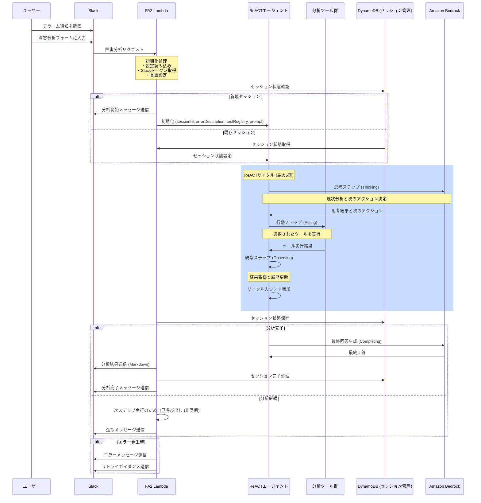

# FA2処理シーケンス

このドキュメントでは、Failure Analysis Assistant (FA2)の処理シーケンスを図で説明します。

## 処理シーケンス図

## 処理フローの説明

1. **初期リクエスト処理**：
   - ユーザーがSlackでアラーム通知を確認し、障害分析フォームに入力
   - FA2 Lambdaが起動し、初期化処理を実行

2. **セッション管理**：
   - 新規セッションの場合は新たにReACTエージェントを初期化
   - 既存セッションの場合は状態を復元

3. **ReACTサイクル**：
   - **思考ステップ（Thinking）**：現状分析と次のアクション決定（Bedrock LLMを使用）
   - **行動ステップ（Acting）**：選択されたツールを実行
   - **観察ステップ（Observing）**：結果観察と履歴更新
   - サイクルカウント増加（最大5回）

4. **処理分岐**：
   - 分析完了：最終回答を生成してSlackに送信
   - 分析継続：次ステップ実行のためLambdaを非同期で再度呼び出し

5. **エラー処理**：
   - エラー発生時はエラーメッセージとリトライガイダンスを送信
