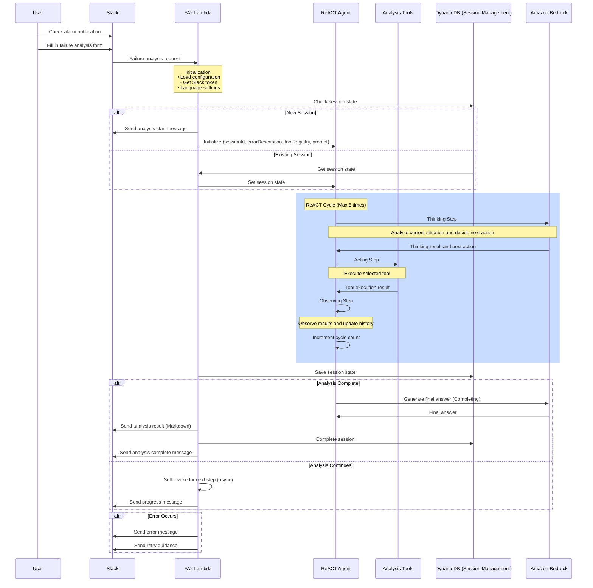

# FA2 Process Sequence

This document explains the process sequence of Failure Analysis Assistant (FA2) with a diagram.

## Process Sequence Diagram

## Process Flow Description

1. **Initial Request Processing**:
   - User checks alarm notification in Slack and fills in the failure analysis form
   - FA2 Lambda starts and performs initialization

2. **Session Management**:
   - For new sessions, initialize a new ReACT agent
   - For existing sessions, restore the state

3. **ReACT Cycle**:
   - **Thinking Step**: Analyze current situation and decide next action (using Bedrock LLM)
   - **Acting Step**: Execute selected tool
   - **Observing Step**: Observe results and update history
   - Increment cycle count (maximum 5 cycles)

4. **Process Branch**:
   - Analysis Complete: Generate final answer and send to Slack
   - Analysis Continues: Invoke Lambda asynchronously for next step

5. **Error Handling**:
   - Send error message and retry guidance when errors occur
